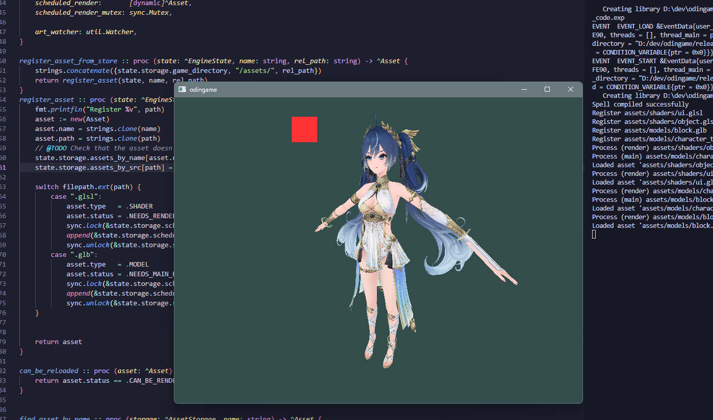

@TODO
- Brief text about game and project
- How to build, install, run
- Dependencies


# Some quick controls

Download Odin compiler and set PATH environment variable. Check with `where odin` in terminal on Windows.

```bash
# Compile and run game with
build.py run
```

|Key|What|
|-|-|
|Mouse|Look around|
|Escape|Show/hide mouse|
|WASD|Move forward, left, back, right|
|Space|Move up|
|C|Move down|
|Left Shift|Move faster|
|F1|Reload assets and game code|
|F2|Turn on/off editor mode (no visual feedback that it's on yet)|

|Editor Keys|What|
|-|-|
|K|Spawn cube 5m in front of camera|
|1|Select Tool|
|2|Move Tool|
|3|Scale Tool|
|4|Rotate Tool (not implemented)|



**I DO NOT OWN THE MODEL IN THE IMAGE, it is Iuno from Wuthering Waves**

# Dev features
- Code, model, texture, shader hot-reloading

# Building
**Dependencies**
- Odin
- GLFW
- OpenGL
- cgltf
- stb_image

Odin provides **GLFW** and **OpenGL bindings** for Windows and Linux.
It also has cgltf and stb_image but on Linux you will need to build them yourself (binaries not provided automatically).

For models, you need to export the blender files.
Not automatic at the moment. **WIP**

Build and run the game:
```bash
build.py run
```

The game folder can be found in: releases/odingame-0.0.1-windows-x86_64/odingame.exe

## IMPORTANT
Use the latest odin. There is a bug with global variable for environment variables that causes crash when using dlls which we are with hotreloading.